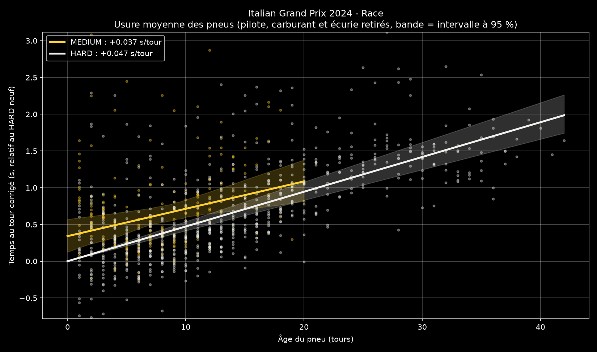
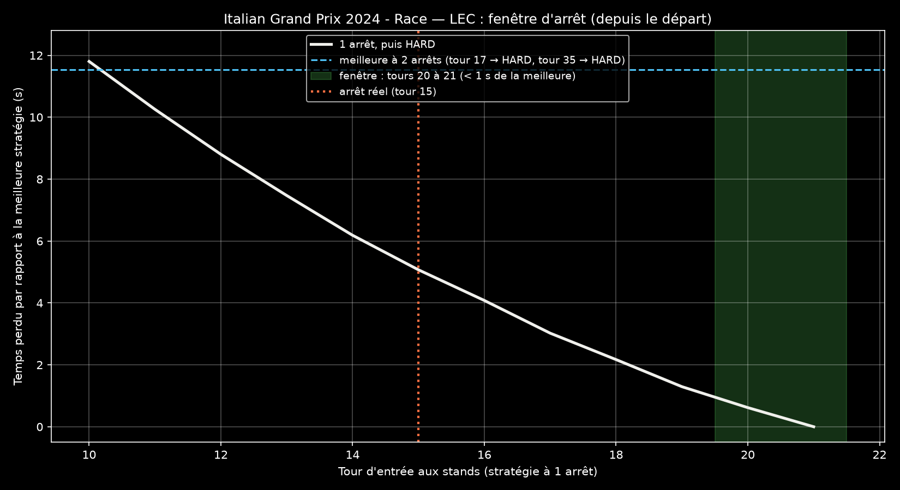
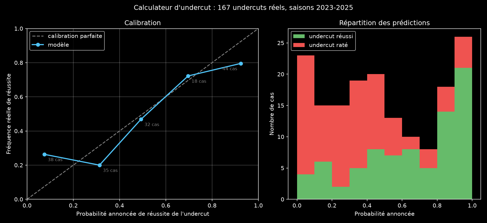

# Télémétrie et stratégie F1

[English](README.md) · **Français**

[](https://github.com/Lowsttt/f1-telemetry-comparison/actions/workflows/tests.yml)

Deux outils construits sur les données publiques de chronométrage de la Formule 1 :

1. **[Comparaison de télémétrie](#partie-1--comparaison-de-télémétrie)** : où et pourquoi un pilote est plus rapide qu'un autre, virage par virage.
2. **[Stratégie des arrêts aux stands](#partie-2--stratégie-des-arrêts-aux-stands)** : modèle d'usure des pneus, calculateur d'undercut et fenêtre d'arrêt, **vérifiés sur 167 undercuts réels de 2023 à 2025** : 73 % de bonnes prédictions, mieux que toutes les règles simples testées.


---

## Partie 1 — Comparaison de télémétrie

Compare le meilleur tour de deux pilotes et produit :

- un **graphique de télémétrie** : vitesse, écart cumulé, accélérateur, frein et rapport, en fonction de la distance ;
- une **carte du circuit** colorée selon le pilote le plus rapide dans chaque zone ;
- un **tableau par zone** (temps gagné, vitesses mini et maxi, point de freinage), exporté en CSV ;
- une **conclusion rédigée automatiquement**.

### Exemple : Monza 2024, qualifications, Leclerc contre Norris

Norris signe la pole en **1:19.327**. Leclerc se qualifie 4e en **1:19.461**, à **0,134 s**. Les deux tours sont faits en pneus tendres.


| Zone | Plus rapide | Gain (s) | Vmin LEC / NOR (km/h) | Vmax LEC / NOR (km/h) | Freinage LEC / NOR (m) |
|---|---|---|---|---|---|
| Départ → T1-T2 (Rettifilo) | LEC | 0,061 | 322 / 321 | 351 / 347 | — |
| T1-T2 (Rettifilo) | NOR | 0,006 | 75 / 73 | 303 / 299 | 743 / 766 |
| T3 (Curva Grande) | LEC | 0,049 | 303 / 302 | 330 / 325 | — |
| T4-T5 (Roggia) | NOR | 0,035 | 111 / 113 | 263 / 263 | 1986 / 1979 |
| T6 (Lesmo 1) | NOR | 0,068 | 204 / 207 | 268 / 269 | 2409 / 2410 |
| T7 (Lesmo 2) | NOR | 0,061 | 187 / 190 | 342 / 338 | 2748 / 2758 |
| T8-T10 (Ascari) | NOR | 0,055 | 191 / 194 | 334 / 329 | 3785 / 3814 |
| T11 (Parabolica) | NOR | 0,018 | 209 / 215 | 321 / 317 | 4986 / 5005 |

*Vmin : vitesse au point le plus lent de la zone. Vmax : vitesse en fin de ligne droite après le virage. Freinage : distance depuis la ligne de départ.*

- **Leclerc va plus vite en ligne droite.** Il est 4 à 5 km/h plus rapide en fin de ligne droite dans 6 zones sur 8 (351 contre 347 km/h avant le Rettifilo). Il gagne ainsi **0,110 s**, uniquement dans les deux zones les plus rapides du circuit : la ligne droite de départ et la Curva Grande.
- **Norris va plus vite en courbe.** Il passe 3 à 6 km/h plus vite au point le plus lent des virages moyens et rapides (Lesmo, Ascari, Parabolica). Il freine aussi plus de 10 m plus tard dans 4 des 6 freinages : 24 m au Rettifilo, 10 m à Lesmo 2, 29 m à Ascari, 18 m à la Parabolica. Il gagne ainsi **0,243 s** sur six zones.
- **Bilan** : ce que Norris gagne en courbe vaut plus que ce que Leclerc gagne en ligne droite, d'où 0,134 s à l'arrivée (0,243 − 0,110, aux arrondis près). Ce profil correspond à une Ferrari réglée avec moins d'appui face à une McLaren plus à l'aise dans les virages. C'est une hypothèse : un seul tour par pilote ne permet pas de séparer l'effet de la voiture de celui du pilote.

> La conclusion produite par le script : « NOR devance LEC de 0.134 s. NOR est plus rapide dans 6 zone(s) sur 8, surtout T6 (+0.068 s) : il passe 3 km/h plus vite au point le plus lent. LEC est plus rapide dans 2 zone(s) sur 8, surtout Départ → T1-T2 (+0.061 s) : il atteint 4 km/h de plus en fin de ligne droite. »

**Autre exemple : Monaco 2024, Leclerc contre Piastri**


### Comment ça marche

- **Meilleur tour** : le tour le plus rapide de chaque pilote, sans les sorties des stands ni les tours supprimés par la direction de course (limites de piste), retrouvés dans ses messages.
- **Distance** : obtenue en intégrant la vitesse. Le tour du pilote 2 est ramené à la longueur de celui du pilote 1 pour comparer les points de freinage au même endroit.
- **Recalage** : OpenF1 ne donne qu'une heure de début de tour approximative, ce qui peut décaler les deux tours de 10 à 20 m. Au freinage, ce décalage crée de faux écarts de plusieurs dixièmes. Le script le corrige en cherchant le décalage qui superpose le mieux les deux courbes de vitesse.
- **Écart cumulé** : les chronos des deux pilotes sont comparés à distance égale, sur une grille commune. Chaque tour est fixé à 0 s au départ et à son temps officiel à l'arrivée, donc la courbe finit exactement sur l'écart officiel.
- **Zones** : une par virage, ou par groupe de virages à moins de 110 m (chicanes). Une zone va de la vitesse maximale avant le virage jusqu'à celle avant le virage suivant. Les gains de toutes les zones s'additionnent donc exactement à l'écart total.
- **Point de freinage** : premier passage « pas de frein → frein » dans les 400 m avant le virage, avec au moins 0,5 s sans frein juste avant. Le signal de frein « clignote » parfois pendant un freinage, et ce critère évite de compter ces coupures.
- **Carte** : la trajectoire réelle du pilote 1, orientée comme le plan officiel du circuit, colorée zone par zone.

**Limites** : la télémétrie publique n'a qu'environ 4 points par seconde, donc un point de freinage n'est connu qu'à une dizaine de mètres près (la conclusion ignore les écarts de moins de 10 m ou de 2 km/h). Un seul tour par pilote : le trafic, le vent ou un tour imparfait pèsent sur le résultat.

---

## Partie 2 — Stratégie des arrêts aux stands

Quatre modules, un point d'entrée (`strategie.py`) :

| Module | Rôle |
|---|---|
| `course.py` | Tableau tour par tour nettoyé d'une course : temps, composé, âge du pneu, arrêts, écart avec la voiture devant, état de la piste (voiture de sécurité, voiture de sécurité virtuelle, drapeau rouge, double drapeau jaune), pluie. Une colonne `exclusion` indique pourquoi un tour ne doit pas servir à mesurer l'usure. |
| `usure.py` | **Modèle d'usure des pneus**, avec marges d'erreur. |
| `undercut.py` | Coût réel d'un arrêt, **calculateur d'undercut et d'overcut**, **fenêtre d'arrêt**, « faut-il rentrer sous voiture de sécurité ? » |
| `validation.py` | **Vérification sur l'historique** : le calculateur prédit-il les vrais undercuts ? |

### Étude de cas : Monza 2024, la victoire de Leclerc avec un seul arrêt

Leclerc a gagné avec un seul arrêt (médium, puis 38 tours en durs). Les deux McLaren se sont arrêtées deux fois : Piastri termine à 2,6 s, Norris 3e.

**1. Usure des pneus.** Temps au tour = rythme du pilote + effet carburant × tour + écart du composé à neuf + (usure du composé + écart de l'écurie) × âge du pneu.



- Effet carburant (la voiture s'allège) : **−0,061 s par tour** [−0,064 ; −0,059].
- Usure : **+0,047 s par tour en dur** [+0,042 ; +0,054], **+0,037 s par tour en médium** [+0,018 ; +0,059].
- Par écurie, sur le dur : Mercedes +0,023, McLaren +0,040, Ferrari +0,055 s par tour. Ferrari usait ses durs plus vite que McLaren, et pourtant un seul arrêt restait le meilleur choix : un arrêt coûte 26 s, plus que l'usure qu'il évite.

**2. Les undercuts des tours 13 à 15.**

| Tentative (tour de décision) | Écart | Chance prédite | Écart final prédit | Ce qui s'est passé |
|---|---|---|---|---|
| NOR sur LEC (tour 13), LEC réagit 1 tour plus tard | 0,80 s | 49 % | +0,0 s [−3,3 ; +3,3] | **Réussi** : NOR devant de 2,3 s |
| LEC sur PIA (tour 14), PIA réagit 1 tour plus tard | 3,56 s | 8 % | +2,8 s [−0,5 ; +6,1] | **Raté** : PIA devant de 3,4 s |

L'échec est clairement prévu. La réussite est un pile ou face pour le modèle, qui a sous-estimé le gain (0,8 s prévu, 3 s en réalité).

**3. Fenêtre d'arrêt.**



- **Un seul arrêt bat deux arrêts dans 100 % des tirages du modèle.**
- Le double arrêt des McLaren leur coûte **environ 13,5 s** par rapport à leur optimum (13,3 s pour Norris, 13,8 s pour Piastri). Le seul arrêt de Leclerc lui coûte 5,1 s : **8 à 9 s d'avance stratégique**, pour une victoire avec 2,6 s d'avance.
- L'optimum tombe au tour 21 parce qu'aucun médium n'a tenu plus de 21 tours dans cette course : l'outil ne prolonge jamais la durée de vie d'un pneu au-delà de ce qui a été observé. Leclerc s'est arrêté plus tôt (tour 15) pour répondre à l'undercut de Norris, ce que la fenêtre d'arrêt, qui modélise une course sans adversaire, ne voit pas.

### Vérification sur 167 undercuts réels (2023-2025)

`validation.py` retrouve chaque vraie tentative d'undercut (A à moins de 3 s derrière B, A s'arrête, B réagit 1 à 5 tours plus tard, sous drapeau vert), puis prédit chacune **avec uniquement les tours connus au moment de décider**. Un composé pas encore roulé dans la course reçoit un a priori appris sur les **courses précédentes uniquement**. Un test vérifie que modifier tous les tours après la décision laisse la prédiction strictement identique.

| Méthode | Bonnes prédictions | Score de Brier (0 = parfait, 0,25 = pile ou face) |
|---|---|---|
| **Modèle** | **73 %** | **0,206** |
| « Écart < 1,2 s » (meilleur seuil, **choisi en connaissant les résultats**) | 67 % | 0,329 |
| « Écart < 2 s » | 63 % | 0,371 |
| « L'undercut marche toujours » | 48 % | 0,521 |



- Par saison : 79 % de bonnes prédictions en 2023 (Brier 0,18), 73 % en 2024 (0,19), **65 % en 2025 (0,26)**.
- Erreur médiane sur l'écart final : **2,1 s** (moyenne 4,4 s, gonflée par quelques incidents comme une pénalité purgée pendant l'arrêt).
- **Le modèle est trop sûr de lui aux extrêmes** : quand il annonce 7 %, l'undercut réussit 26 % du temps ; quand il annonce 92 %, 80 %. Un terme d'« aléa non modélisé » appris sur les saisons passées n'aide presque pas (Brier sur 2025 : 0,261 → 0,258) et n'a donc pas été ajouté : la faiblesse de 2025 vient de la prédiction centrale, pas de la largeur des probabilités. C'est la principale piste d'amélioration.

### Méthode et garde-fous

- **Régression robuste** (Huber) : les tours encore un peu perturbés pèsent moins.
- **Marges d'erreur** par un bootstrap « sauvage » par relais : les écarts au modèle sont recombinés relais par relais avec un signe tiré au hasard, si bien que chaque pilote et chaque composé restent présents dans chaque tirage.
- **Écart par écurie** et **effet carburant** rappelés doucement vers une valeur typique (ridge). Avant les premiers arrêts, l'âge du pneu avance exactement comme le numéro du tour : les données seules ne permettent pas de séparer carburant et usure.
- **Coût d'un arrêt mesuré** sur les arrêts sous drapeau vert de la course (Monza : 26,0 s, MultiViewer : 25,4 s).
- **Contre le piège de l'optimiseur** : la fenêtre d'arrêt ne propose que les composés roulés sur au moins 5 relais propres, et aucun relais plus long que le plus long observé dans la course. Sans ça, elle recommandait 30 tours en tendres à Singapour 2023, sur la foi de 3 relais.
- **Qualité des données** : les tours sous voiture de sécurité, les relances, les doubles drapeaux jaunes, la pluie, les tours d'arrêt et les tours anormalement lents sont exclus. Bahreïn 2023 n'a aucun arrêt dans OpenF1 : les tours d'entrée aux stands sont déduits des tours de sortie.

**Limites** : le calculateur modélise une course sans adversaire : pas de trafic à la sortie des stands, pas de difficulté de dépassement, pas de valeur de la position en piste. Usure linéaire, donc pas de chute brutale en fin de vie du pneu. Données OpenF1 à partir de 2023.

---

## Installation

Il faut Python 3.11 ou plus récent.

```bash
git clone https://github.com/Lowsttt/f1-telemetry-comparison.git
cd f1-telemetry-comparison
pip install -r requirements.txt
```

## Utilisation

**Comparaison de télémétrie**

```bash
python comparaison_telemetrie.py                            # Monza 2024, qualifications, LEC contre NOR
python comparaison_telemetrie.py 2024 Monaco Q LEC PIA      # année, Grand Prix, session, pilote 1, pilote 2
python comparaison_telemetrie.py --help
```

| Argument | Valeurs | Défaut |
|---|---|---|
| `annee` | 2023 et après avec OpenF1 | `2024` |
| `grand_prix` | nom du lieu, du circuit ou du Grand Prix (`Monza`, `Silverstone`, `"Abu Dhabi"`…) | `Monza` |
| `session` | `FP1`, `FP2`, `FP3`, `Q`, `SQ` (qualifs sprint), `S` (sprint), `R` (course) | `Q` |
| `pilote_1`, `pilote_2` | code à 3 lettres (`LEC`, `NOR`, `VER`…) | `LEC`, `NOR` |
| `--source` | `openf1` ou `fastf1` | `openf1` |
| `--no-show` | enregistre les images sans les afficher | désactivé |

**Stratégie des arrêts aux stands**

```bash
python strategie.py course     2024 Monza               # tableau tour par tour nettoyé
python strategie.py usure      2024 Monza               # usure des pneus par composé et par écurie
python strategie.py duel       2024 Monza 13 NOR LEC    # undercut de NOR sur LEC, décision au tour 13
python strategie.py fenetre    2024 Monza LEC           # meilleure stratégie d'arrêts de LEC
python strategie.py fenetre    2023 Singapore SAI --depuis 19 --sc 20   # rentrer sous voiture de sécurité ?
python strategie.py validation 2023 2025                # vérification sur les undercuts réels (~15 min la 1re fois)
```

Chaque commande accepte `--help`. Les données téléchargées sont gardées en cache (`cache_openf1/`). Les requêtes sont espacées pour respecter la limite gratuite d'OpenF1 : le premier téléchargement d'une saison entière prend quelques minutes.

---

## Données

- **[OpenF1](https://openf1.org)** (source par défaut) : API publique et gratuite, à partir de 2023 : tours, télémétrie, positions, pneus, arrêts, écarts, messages de la direction de course, météo.
- **[MultiViewer](https://multiviewer.app)** : position des virages, orientation des circuits, temps perdu de référence pour un arrêt.
- **[FastF1](https://github.com/theOehrly/Fast-F1)** (`--source fastf1`, comparaison de télémétrie seulement) : elle remonte avant 2023, mais depuis le 15 octobre 2026 l'archive F1 qu'elle utilise exige une authentification ([Fast-F1#978](https://github.com/theOehrly/Fast-F1/issues/978)).

## Tests et qualité

```bash
pip install -r requirements-dev.txt
ruff check .
pytest
```

Les 91 tests tournent **sans réseau**, en une seconde environ. Des courses synthétiques aux paramètres connus vérifient que les modèles les retrouvent (usure, effet carburant, coût d'un arrêt, tour d'arrêt optimal). Des réponses d'API simulées testent le chargement des données (tours supprimés, cache, limite de débit, arrêts manquants). Un test dédié vérifie que la validation n'utilise jamais de données du futur. GitHub Actions lance ruff et les tests à chaque push, sur Python 3.11, 3.12 et 3.13.

## Structure

```
├── comparaison_telemetrie.py   Comparaison de télémétrie : arguments, graphiques, carte
├── analyse.py                  Écart cumulé, zones, bilan, conclusion
├── sources.py                  Chargement OpenF1 / FastF1, cache, limite de débit
├── strategie.py                Point d'entrée de l'outil de stratégie
├── course.py                   Tableau tour par tour nettoyé d'une course
├── usure.py                    Modèle d'usure des pneus
├── undercut.py                 Coût d'un arrêt, calculateur d'undercut, fenêtre d'arrêt
├── validation.py               Vérification sur les undercuts réels 2023-2025
├── tests/                      Tests pytest (sans réseau)
├── docs/images/                Images du README
├── requirements.txt            Dépendances
├── requirements-dev.txt        Outils de test et de lint
└── pyproject.toml              Configuration de ruff et pytest
```

## Licence

[MIT](LICENSE) : libre d'utilisation, de modification et de partage, à condition de garder la mention de copyright.

---

Projet personnel de Rayan Bouyacoub, étudiant en cybersécurité, qui s'intéresse aux métiers du développement et de la data en Formule 1.

*Projet non officiel, sans lien avec la Formule 1, la FIA ou les écuries. F1 et FORMULA 1 sont des marques de Formula One Licensing B.V.*
