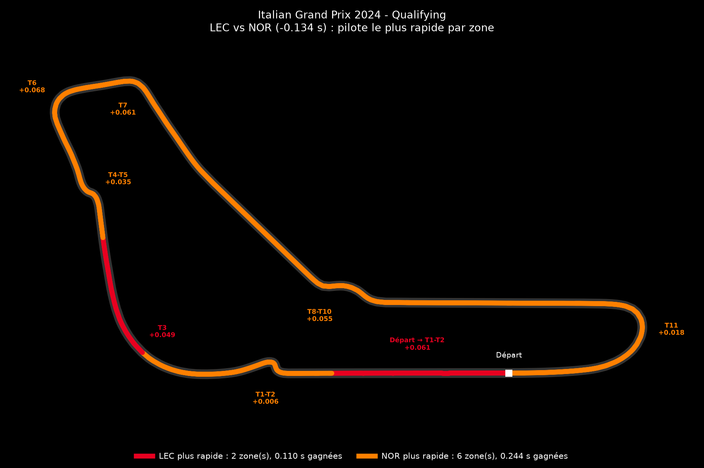
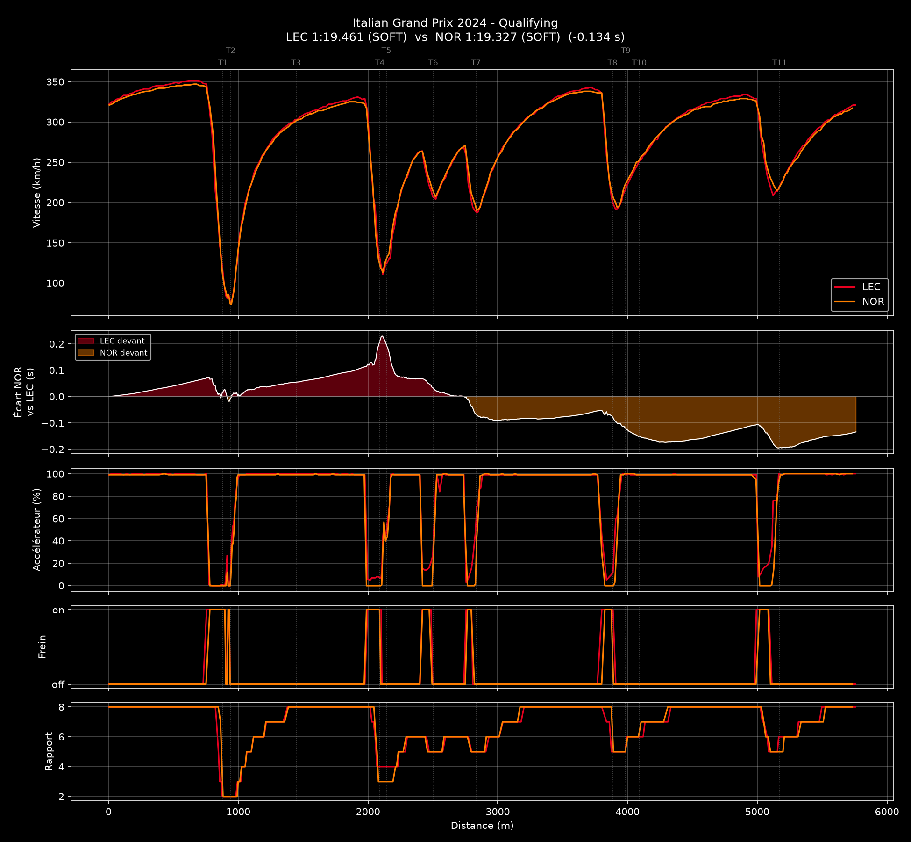
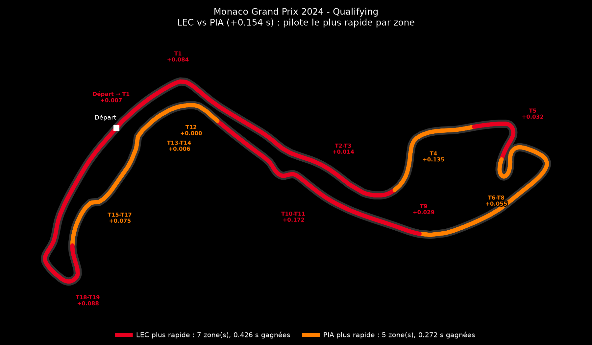

# F1 Telemetry Comparison

**English** · [Français](README.fr.md)

[](https://github.com/Lowsttt/f1-telemetry-comparison/actions/workflows/tests.yml)

Compares the fastest laps of two Formula 1 drivers and explains **where and why** one is faster than the other, corner by corner.

From public timing data, the script produces:

- a **telemetry chart**: speed, cumulative time delta, throttle, brake and gear, plotted against distance;
- a **track map** coloured by the faster driver in each section;
- a **per-section table** (time gained, minimum and maximum speeds, braking point), exported to CSV;
- an **automatically written summary**.



*The tool's console output and chart labels are in French (e.g. "Vitesse" = speed, "Écart" = delta, "Frein" = brake, "Rapport" = gear).*

---

## Example: Monza 2024, qualifying, Leclerc vs Norris

Norris took pole with a **1:19.327**. Leclerc qualified 4th with a **1:19.461**, **0.134 s** behind. Both laps were set on soft tyres.



| Section | Faster | Gain (s) | Min speed LEC / NOR (km/h) | Max speed LEC / NOR (km/h) | Braking LEC / NOR (m) |
|---|---|---|---|---|---|
| Start → T1-T2 (Rettifilo) | LEC | 0.061 | 322 / 321 | 351 / 347 | — |
| T1-T2 (Rettifilo) | NOR | 0.006 | 75 / 73 | 303 / 299 | 743 / 766 |
| T3 (Curva Grande) | LEC | 0.049 | 303 / 302 | 330 / 325 | — |
| T4-T5 (Roggia) | NOR | 0.035 | 111 / 113 | 263 / 263 | 1986 / 1979 |
| T6 (Lesmo 1) | NOR | 0.068 | 204 / 207 | 268 / 269 | 2409 / 2410 |
| T7 (Lesmo 2) | NOR | 0.061 | 187 / 190 | 342 / 338 | 2748 / 2758 |
| T8-T10 (Ascari) | NOR | 0.055 | 191 / 194 | 334 / 329 | 3785 / 3814 |
| T11 (Parabolica) | NOR | 0.018 | 209 / 215 | 321 / 317 | 4986 / 5005 |

*Min speed: speed at the slowest point of the section. Max speed: speed at the end of the straight after the corner. Braking: distance from the start/finish line.*

### What the data shows

- **Leclerc is faster on the straights.** He is 4 to 5 km/h quicker at the end of the straight in 6 sections out of 8 (351 vs 347 km/h before the Rettifilo). That earns him **0.110 s**, all of it in the two fastest sections of the track: the start/finish straight and the Curva Grande.
- **Norris is faster through the corners.** He carries 3 to 6 km/h more speed at the slowest point of the medium and high-speed corners (Lesmo, Ascari, Parabolica). He also brakes more than 10 m later in 4 of the 6 braking zones: 24 m at the Rettifilo, 10 m at Lesmo 2, 29 m at Ascari and 18 m at the Parabolica. That earns him **0.243 s** over six sections.
- **Overall**: what Norris gains in the corners outweighs what Leclerc gains on the straights, hence the 0.134 s gap at the line (0.243 − 0.110, within rounding). This pattern is consistent with a lower-downforce Ferrari (quicker on the straights, slower in the corners) against a McLaren that is stronger through the turns. That is a hypothesis: a single lap per driver cannot separate the car's contribution from the driver's.

> Summary written by the script (in French): « NOR devance LEC de 0.134 s. NOR est plus rapide dans 6 zone(s) sur 8, surtout T6 (+0.068 s) : il passe 3 km/h plus vite au point le plus lent. LEC est plus rapide dans 2 zone(s) sur 8, surtout Départ → T1-T2 (+0.061 s) : il atteint 4 km/h de plus en fin de ligne droite. »
>
> *Translation: NOR beats LEC by 0.134 s. NOR is faster in 6 sections out of 8, especially T6 (+0.068 s): he is 3 km/h faster at the slowest point. LEC is faster in 2 sections out of 8, especially Start → T1-T2 (+0.061 s): he reaches 4 km/h more at the end of the straight.*

### Another example: Monaco 2024, Leclerc vs Piastri



---

## Installation

Requires Python 3.11 or newer.

```bash
git clone https://github.com/Lowsttt/f1-telemetry-comparison.git
cd f1-telemetry-comparison
pip install -r requirements.txt
```

## Usage

```bash
# Defaults: Monza 2024, qualifying, LEC vs NOR
python comparaison_telemetrie.py

# Year, Grand Prix, session, driver 1, driver 2
python comparaison_telemetrie.py 2024 Monaco Q LEC PIA
python comparaison_telemetrie.py 2024 "Abu Dhabi" R LEC SAI

# Save the images without opening a window
python comparaison_telemetrie.py 2024 Monza Q LEC NOR --no-show

# All options
python comparaison_telemetrie.py --help
```

| Argument | Values | Default |
|---|---|---|
| `annee` (year) | 2023 onwards with OpenF1 | `2024` |
| `grand_prix` | location, circuit or Grand Prix name (`Monza`, `Silverstone`, `"Abu Dhabi"`…) | `Monza` |
| `session` | `FP1`, `FP2`, `FP3`, `Q`, `SQ` (sprint qualifying), `S` (sprint), `R` (race) | `Q` |
| `pilote_1`, `pilote_2` (drivers) | three-letter code (`LEC`, `NOR`, `VER`…) | `LEC`, `NOR` |
| `--source` | `openf1` or `fastf1` | `openf1` |
| `--no-show` | save the images without displaying them | off |

The script prints the table and the summary to the terminal and writes three files: `telemetrie_<…>.png` (telemetry chart), `carte_<…>.png` (track map) and `analyse_<…>.csv` (per-section table). Downloaded data is cached in `cache_openf1/`, so a second run is instant.

---

## How it works

```
sources.py           Data loading (OpenF1 or FastF1), same output format
   │
analyse.py           Cumulative delta, section split, per-section table and summary
   │
comparaison_telemetrie.py   Command line, charts and track map
```

- **Fastest lap**: each driver's quickest lap, excluding pit-out laps and laps deleted by race control (track limits), which are read from the race control messages.
- **Distance**: obtained by integrating speed. Driver 2's lap is scaled to the length of driver 1's, so braking points are compared at the same place on track.
- **Alignment**: OpenF1 only gives an approximate lap start time, which can shift the two laps 10 to 20 m apart. Under braking, that shift creates fake gaps of several tenths. The script corrects it by finding the offset that best overlays the two speed traces.
- **Cumulative delta**: the two drivers' elapsed times are compared at equal distance on a common grid. Each lap is pinned to 0 s at the start and to its official lap time at the finish, so the curve ends exactly on the official gap.
- **Sections**: one per corner, or per group of corners less than 110 m apart (chicanes). A section runs from the top speed before the corner to the top speed before the next one: braking, corner, exit and the following straight. The section gains therefore add up exactly to the total gap.
- **Braking point**: the first "brake off → brake on" transition within 400 m before the corner, with at least 0.5 s off the brake just before. The brake signal sometimes flickers during a braking phase, and this rule stops those dropouts from counting.
- **Track map**: driver 1's actual racing line, rotated to match the official circuit map and coloured section by section.

### Limitations

- Public telemetry only has **about 4 samples per second**. A braking point is therefore only known to within about ten metres, and the summary ignores differences below 10 m or 2 km/h.
- **One lap per driver**: traffic, wind or an imperfect lap all affect the result.
- OpenF1 only covers the **2023 season onwards**.

---

## Data

- **[OpenF1](https://openf1.org)** (default source): free public API, from 2023 onwards. It provides laps, telemetry, car positions, tyres and race control messages.
- **[MultiViewer](https://multiviewer.app)**: corner positions and circuit map orientation.
- **[FastF1](https://github.com/theOehrly/Fast-F1)** (`--source fastf1`): goes back before 2023, but since 15 October 2026 the F1 archive it relies on requires authentication ([Fast-F1#978](https://github.com/theOehrly/Fast-F1/issues/978)). OpenF1 is therefore the default until that is fixed.

## Tests and code quality

```bash
pip install -r requirements-dev.txt
ruff check .
pytest
```

The 27 tests run **without network access** in under a second:

- the analysis is checked on synthetic laps whose result is known in advance;
- the OpenF1 source is tested against simulated API responses: deleted laps, caching, retries after an HTTP 429 (too many requests), lap alignment.

The GitHub Actions workflow ([`.github/workflows/tests.yml`](.github/workflows/tests.yml)) runs ruff and the tests on every push, on Python 3.11, 3.12 and 3.13.

## Project structure

```
├── comparaison_telemetrie.py   Entry point: arguments, charts, track map
├── analyse.py                  Cumulative delta, sections, table, summary
├── sources.py                  OpenF1 / FastF1 loading
├── tests/                      pytest tests (no network)
├── docs/images/                README images
├── requirements.txt            Dependencies
├── requirements-dev.txt        Test and lint tools
└── pyproject.toml              ruff and pytest configuration
```

## License

[MIT](LICENSE): free to use, modify and share, as long as the copyright notice is kept.

---

Personal project by Rayan Bouyacoub, a cybersecurity student interested in software and data roles in Formula 1.

*Unofficial project, not associated with Formula 1, the FIA or any team. F1 and FORMULA 1 are trademarks of Formula One Licensing B.V.*
